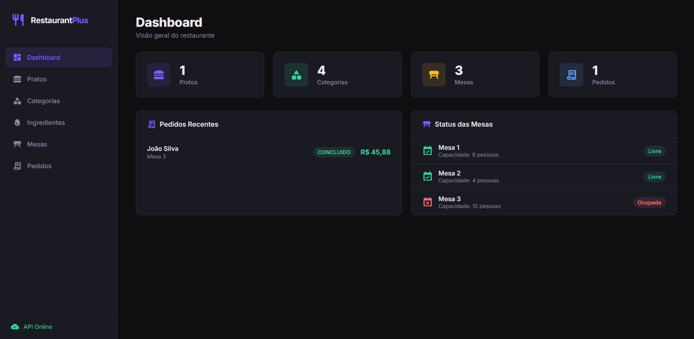
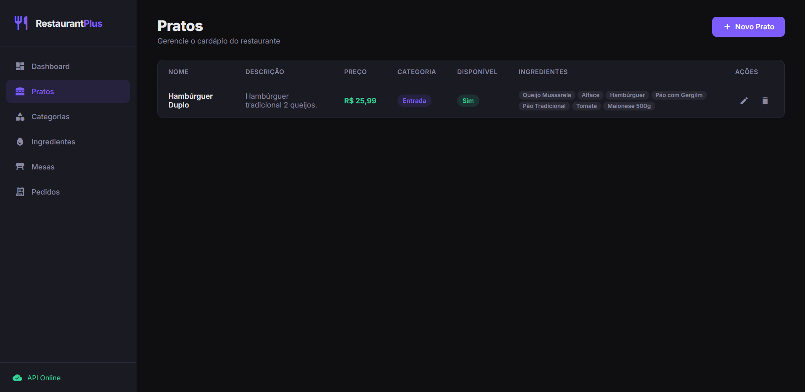
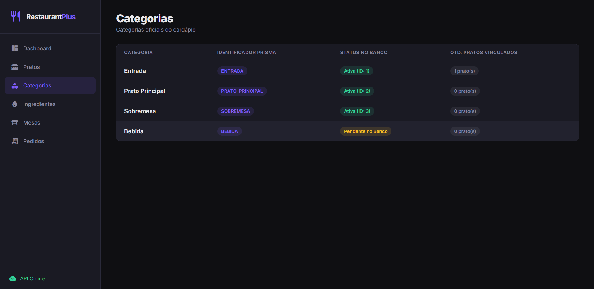
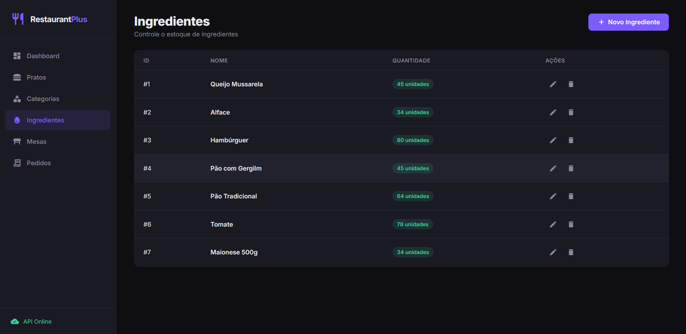
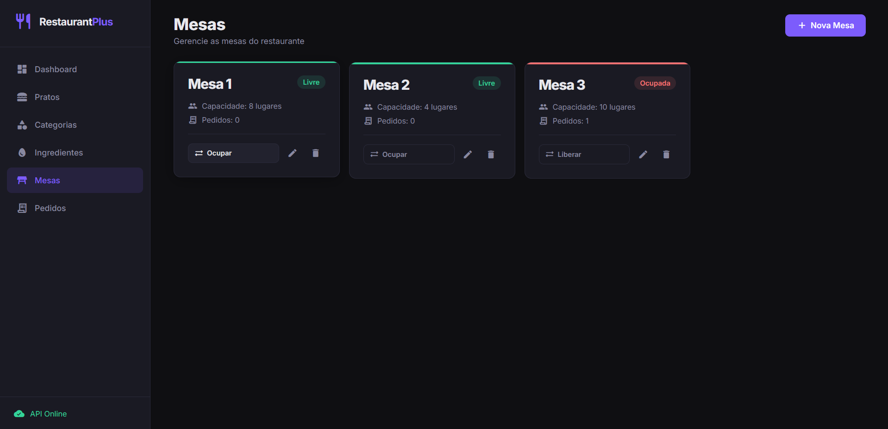
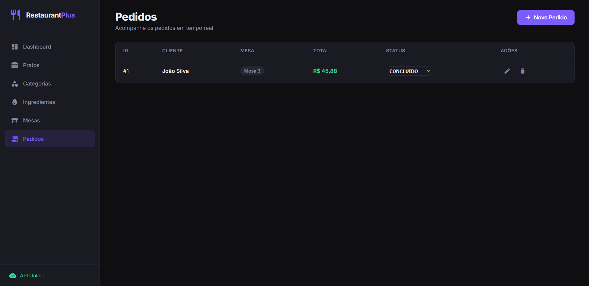

# RestaurantPlus - Frontend

Interface moderna de gerenciamento para o sistema RestaurantPlus. Este frontend foi desenvolvido e estilizado com auxílio de Inteligência Artificial para proporcionar uma experiência visual aprimorada, fluida e intuitiva, conectando-se diretamente à API REST em produção na Vercel.

## Complementar

Este readme é um complemento ao readme do [Backend](../README.md).

## Visão Geral

- **SPA (Single Page Application)** leve, responsiva e dinâmica em HTML5, CSS3 moderno e Vanilla JavaScript.
- **Dark Theme profissional** com glassmorphism, microinterações e tipografia Inter.
- **Reatividade em tempo real**: alterações, cadastros, exclusões e mudanças de status atualizam a interface instantaneamente sem necessidade de recarregar a página.
- **Sem imagens de pratos**: design focado em métricas, dados organizados, status visuais e controle do restaurante.

---

## Telas do Sistema (Screenshots)

### 1. Dashboard Principal
Visão consolidada do restaurante com contadores de recursos, status das mesas e pedidos recentes.

---

### 2. Gerenciamento de Pratos
Listagem completa do cardápio com preços, categorias oficiais, disponibilidade e ingredientes associados.

---

### 3. Categorias Oficiais
Visualização das categorias estruturadas pelo enum do Prisma com quantidade de pratos vinculados.

---

### 4. Controle de Ingredientes
Controle e listagem de estoque de ingredientes cadastrados para composição dos pratos.

---

### 5. Gestão de Mesas
Grid interativo com visualização da capacidade, pedidos e alternância rápida de ocupação (Livre / Ocupada) em um clique.

---

### 6. Acompanhamento de Pedidos
Controle de pedidos em tempo real com alteração imediata de status (`PENDENTE`, `PREPARANDO`, `CONCLUIDO`, `CANCELADO`).

---

## Estrutura da Pasta

- `index.html`: Interface principal da aplicação (SPA).
- `style.css`: Estilização completa do layout, temas e componentes.
- `script.js`: Toda a lógica de conexão com a API, manipulação de DOM, modais dinâmicos e reatividade.

---

## Integração com a API

O frontend consome a API REST hospedada em:
`https://restaurantplus-backend.vercel.app/`

### Recursos Conectados:
- **Pratos (`/pratos/*`)**: Listagem, criação com vínculo relacional (categoria e múltiplos ingredientes), edição de dados/ingredientes e exclusão.
- **Categorias (`/categorias/*` e `/enums/categorias`)**: Consumo direto das categorias do esquema Prisma (`ENTRADA`, `PRATO_PRINCIPAL`, `SOBREMESA`, `BEBIDA`).
- **Ingredientes (`/ingredientes/*`)**: Cadastro, atualização de estoque e exclusão.
- **Mesas (`/mesas/*`)**: Cadastro de mesas com número e capacidade, controle de ocupação e exclusão.
- **Pedidos (`/pedidos/*` e `/enums/status-pedido`)**: Registro de pedidos vinculados às mesas e acompanhamento dinâmico de status.

---
